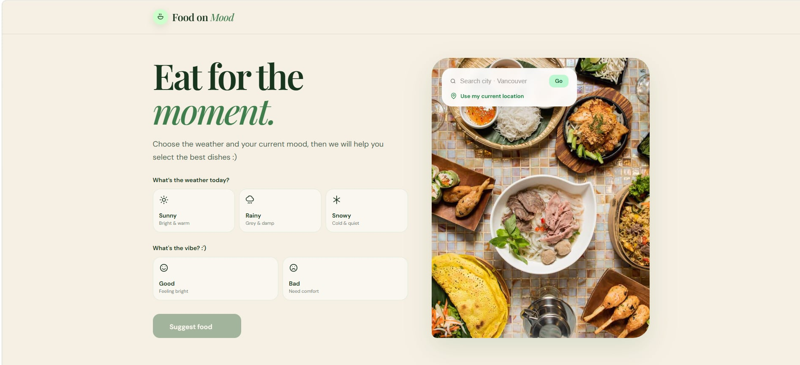
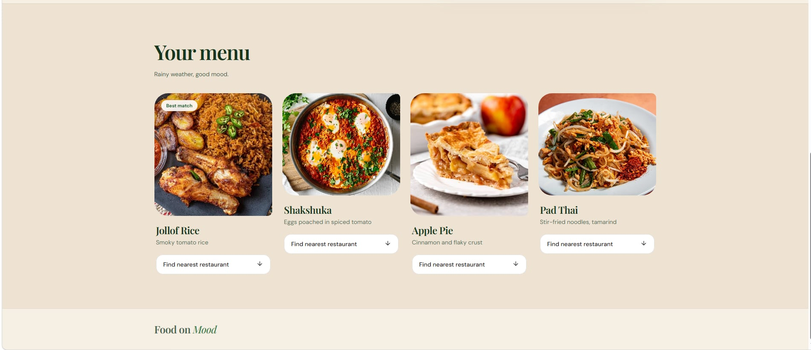

# 🍜 Food on Mood

**Eat for the moment.**

Food on Mood is a food recommendation web assitant that suggests dishes based on the user's current weather and mood.

## Features

- **Weather-based recommendations:** Choose Sunny, Rainy, or Snowy weather.
- **Mood-based users:** Choose between Good and Bad moods.
- **Location search:** Search for a city to retrieve its current weather to auto set weather.
- **Current location:** Use GPS to detect local weather.
- **Food suggestions:** Get food recommendations raise your appetite.

## Technologies Used

- React
- JavaScript
- HTML & CSS
- Vite
- Open-Meteo Weather API
- googlemap API

## Screenshots

### Homepage


### Food Recommendations


## Getting Started

### Prerequisites

- Node.js
- npm

### Installation

1. Clone the repository:

   ```bash
   git clone https://github.com/.../Fall-Hacks-Project.git
   ```

2. Navigate to the project folder:

   ```bash
   cd ~/Fall-Hacks-Project/food-on-mood
   ```

3. Install dependencies:

   ```bash
   npm install
   npm install @googlemaps/js-api-loader
   ```

4. Start the development server:

   ```bash
   npm run dev
   ```

5. Open the local URL displayed in your terminal or click on the link.

## Weather API

This project uses the Open-Meteo API to retrieve weather information based on geographic coordinates.

Website: https://open-meteo.com/

## Contributors

- @nalebao      aka NA DIEN aka rusher aka whyyyyy
- @Dylansayhj   aka superstar
- @Grass135     aka silent treatment
- @andrewhuynh6 aka handsome

## License

This project was created for fall hackathon. YEAHHHHH!!!!!!!
